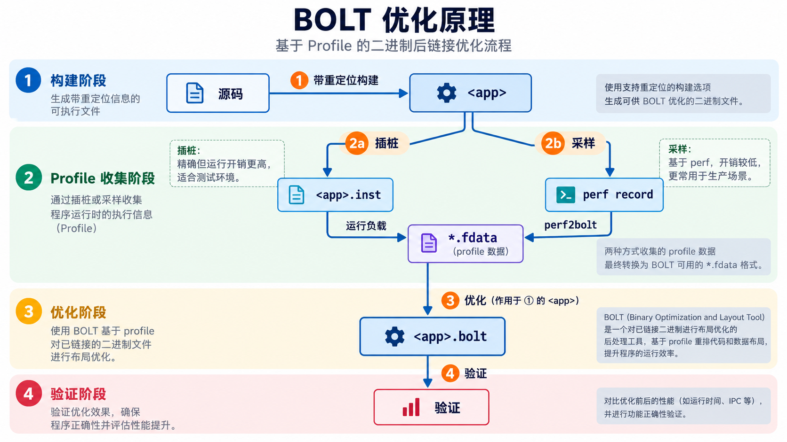

# Rust 程序的 BOLT 优化

> 本文介绍 BOLT 的原理和通用操作步骤，适用于任意 Rust 程序。以 ripgrep 为例的完整实践、复现脚本与实测数据见 [PRACTICE.md](PRACTICE.md)。

## 1. 介绍

BOLT（Binary Optimization and Layout Tool）是 LLVM 项目中的**链接后优化器**。它不参与编译，而是读取已经链接好的可执行文件，根据程序运行时的 profile 重新排列其中的机器码，再输出一个新的可执行文件。

BOLT 只做一件事：**优化代码布局**。它让经常一起执行的指令在内存中挨在一起，使 CPU 更好地利用指令缓存和分支预测。

**适用场景**：

- 代码量大、指令缓存（i-cache）和 iTLB 未命中多的程序，例如编译器、数据库、大型服务端程序。
- 已经做过 PGO、LTO，希望进一步提升性能的程序。BOLT 是编译器优化的补充，而不是替代。Rust 官方发布的 Linux x86_64 版 rustc 就同时使用了 PGO 和 BOLT。

**限制**：

- 主要面向 Linux 上的 ELF 二进制。macOS 上有初步的 Mach-O 支持，Windows 上目前不可用。架构方面常用的是 x86_64 和 AArch64，完整的支持范围以所用 LLVM 版本的文档为准。
- 收益取决于程序本身。热点代码很少、或时间主要花在 I/O 和系统调用上的程序，收益有限。

**版本要求**：BOLT 从 **LLVM 14** 起随 LLVM 发布。本文的命令需要 **LLVM 18 及以上**（用到了 `cdsort`），LLVM 14–17 的替代写法见 3.6 节。

## 2. 基本原理

### 2.1 代码布局为什么影响性能

CPU 执行一条指令前，要先完成取指：

1. 通过 **iTLB** 把指令的虚拟地址翻译成物理地址；
2. 从 **i-cache** 中读取指令，未命中时要从更慢的 L2、L3 或内存中读取；
3. 遇到跳转时，由**分支预测器**决定下一条指令从哪里取。

iTLB 和 i-cache 的容量都很小（典型的 L1 i-cache 只有 32 KB）。如果热代码分散在整个二进制中，未命中就会频繁发生，CPU 只能停下来等待取指。

热代码之所以分散，是因为编译器看不到全局：标准库、各个 crate、C 依赖分别编译，最后才由链接器按固定规则拼在一起。编译器也不知道运行时哪些分支常走、哪些函数常被调用。

### 2.2 BOLT 如何解决

BOLT 在链接之后工作，面对的是**最终的完整机器码**，并且掌握运行时 profile。它的工作过程如下：

1. **反汇编**：读取 ELF 文件，把每个函数反汇编，构建控制流图（CFG）。
2. **关联 profile**：把 profile 中的执行次数标注到控制流图的边上。
3. **优化布局**：
   - **基本块重排**：在函数内部，把常走的路径排成顺序执行，减少跳转。
   - **函数拆分**：把函数拆成热、冷两部分，冷的部分移到远处。
   - **函数重排**：把经常相继调用的函数放在相邻位置。
4. **重写二进制**：输出新的 ELF 文件，并修正所有受影响的地址引用。

结果是热代码被压缩到一块连续的小区域，**i-cache 和 iTLB 未命中显著减少**，跳转也更少。BOLT 基本不改变执行哪些指令，只改变指令放在哪里。

### 2.3 为什么需要重定位信息

重定位信息记录了"二进制中哪些位置引用了哪个地址"。BOLT 移动函数后，必须据此修正所有引用。

链接器默认会在输出文件中丢弃这些信息，因此构建时要让链接器保留它们，即链接参数 `--emit-relocs`（简写 `-q`）。没有重定位信息时，BOLT 只能在每个函数原有的位置上调整，无法移动函数，收益会小很多。

### 2.4 profile 从哪里来

BOLT 需要知道每条分支实际执行了多少次。有两种获取方式：

| 方式 | 原理 | 优点 | 缺点 |
|:---|:---|:---|:---|
| 插桩 | BOLT 在二进制的分支处插入计数器，运行插桩版程序得到 profile | 计数精确，不依赖硬件 | 插桩版程序明显变慢 |
| 采样 | 用 `perf` 在原程序运行时采样，再转换为 BOLT 的 profile | 开销小，可直接用于生产环境 | 精度依赖 CPU 的分支记录功能（如 Intel 的 LBR），部分 CPU 和虚拟机不提供 |

两种方式得到的都是 `.fdata` 文件，后续的优化步骤相同。

### 2.5 与 PGO 的关系

| | PGO | BOLT |
|:---|:---|:---|
| 作用阶段 | 编译期，作用于 LLVM IR | 链接后，作用于机器码 |
| 改变什么 | 内联、分支布局等编译决策 | 指令在二进制中的位置 |
| 主要收益 | 执行的指令更少 | i-cache / iTLB 未命中更少 |

两者可以叠加，顺序必须是**先 PGO，后 BOLT**：PGO 决定生成什么机器码，BOLT 再对最终的机器码做布局。

## 3. 操作步骤

### 3.1 流程总览



| 步骤 | 目的 | 输入 | 输出 |
|:---|:---|:---|:---|
| 0. 准备环境 | 安装 BOLT | — | `llvm-bolt`、`merge-fdata`、`perf2bolt` |
| 1. 带重定位构建 | 得到 BOLT 能够重排的二进制 | 源码 | `<app>` |
| 2a. 插桩采集 | 获取 profile（插桩方式） | `<app>` | `<app>.fdata` |
| 2b. 采样采集 | 获取 profile（采样方式），与 2a 二选一 | `<app>` | `<app>.fdata` |
| 3. 优化 | 按 profile 重排二进制 | `<app>` + `<app>.fdata` | `<app>.bolt` |
| 4. 验证 | 确认行为不变、性能提升 | `<app>`、`<app>.bolt` | 对比结果 |

下文用 `<app>` 表示你的程序名，`<workload>` 表示能代表真实使用场景的运行参数，`<triple>` 表示目标平台（如 `x86_64-unknown-linux-gnu`）。

### 3.2 步骤 0：准备环境

**目的**：安装 BOLT 工具链。

**命令**（Ubuntu / Debian，以 LLVM 21 为例）：

```bash
wget https://apt.llvm.org/llvm.sh
sudo bash llvm.sh 21
sudo apt install bolt-21
export PATH=/usr/lib/llvm-21/bin:$PATH
```

**说明**：

| 工具 | 用途 |
|:---|:---|
| `llvm-bolt` | 插桩与优化 |
| `merge-fdata` | 合并多个 `.fdata` |
| `perf2bolt` | 把 `perf` 采样数据转换为 `.fdata`（仅采样方式需要） |

BOLT 处理的是机器码，版本无需与 rustc 内置的 LLVM 一致。

**检查**：`llvm-bolt --version` 能输出版本号。

### 3.3 步骤 1：带重定位构建

**目的**：得到一个保留了重定位信息和符号表的二进制。

**命令**：

```bash
RUSTFLAGS="-Clink-args=-Wl,-q" cargo build --release --target <triple>
```

**说明**：

| 参数 | 含义 |
|:---|:---|
| `-Clink-args=-Wl,-q` | rustc 把 `-Wl,-q` 交给链接器，链接器保留重定位信息 |
| `--target <triple>` | 显式指定 target 后，`RUSTFLAGS` 只作用于目标程序，不作用于 build script 和过程宏 |

此外，**不要剥离符号表**：`Cargo.toml` 的 profile 中不能设置 `strip = "symbols"` 或 `strip = true`。BOLT 依靠符号表识别函数。

**输出**：`target/<triple>/release/<app>`

**检查**：

```bash
readelf -S <app> | grep rela.text     # 有输出：重定位信息已保留
readelf -S <app> | grep symtab        # 有输出：符号表存在
```

### 3.4 步骤 2a：插桩采集

**目的**：用插桩版程序运行典型负载，得到精确的 profile。

**命令**：

```bash
# 1. 生成插桩版程序
llvm-bolt <app> -instrument -o <app>.inst \
  --instrumentation-file=/tmp/bolt/prof.fdata \
  --instrumentation-file-append-pid

# 2. 用插桩版程序运行典型负载，可以运行多次
./<app>.inst <workload>

# 3. 合并多次运行的 profile
merge-fdata /tmp/bolt/prof.fdata.*.fdata > <app>.fdata
```

**说明**：

| 参数 | 含义 |
|:---|:---|
| `-instrument` | 生成插桩版程序，而不是做优化 |
| `-o <app>.inst` | 插桩版程序的输出路径 |
| `--instrumentation-file=<路径>` | 插桩版程序退出时把 profile 写到这里 |
| `--instrumentation-file-append-pid` | 文件名追加进程号（`prof.fdata.<pid>.fdata`），多次运行互不覆盖 |

对于不会主动退出的服务端程序，还可以使用：

| 参数 | 含义 |
|:---|:---|
| `--instrumentation-sleep-time=<秒>` | 每隔指定秒数写一次 profile，不必等程序退出 |
| `--instrumentation-no-counters-clear` | 每次写出后不清零计数，profile 持续累积 |
| `--instrumentation-wait-forks` | 等待所有子进程结束后再写出 |

**输出**：`<app>.fdata`

**检查**：每次运行都生成了一个非空的 `prof.fdata.<pid>.fdata`。

### 3.5 步骤 2b：采样采集

**目的**：在原程序（步骤 1 的 `<app>`）运行时采样。开销小，适合生产环境。与步骤 2a 二选一。

**命令**（CPU 支持 LBR，例如 Intel 物理机）：

```bash
# 1. 采样
perf record -e cycles:u -j any,u -o perf.data -- ./<app> <workload>
# 2. 转换为 BOLT 的 profile
perf2bolt -p perf.data -o <app>.fdata ./<app>
```

**命令**（CPU 不支持 LBR，例如多数 AArch64 机器、部分虚拟机）：

```bash
perf record -e cycles:u -o perf.data -- ./<app> <workload>
perf2bolt -p perf.data -o <app>.fdata -nl ./<app>
```

**说明**：

| 参数 | 含义 |
|:---|:---|
| `-e cycles:u` | 只对用户态的 cycles 事件采样 |
| `-j any,u` | 同时记录用户态的分支（依赖 LBR），BOLT 由此得到每次跳转的来源和目标 |
| `perf2bolt -p <文件>` | 输入的 `perf.data` |
| `-nl` | 输入不含分支记录，只能统计各位置的执行次数，精度较低 |

判断是否支持 LBR：用第一组命令采样后，执行 `perf report -i perf.data --header-only | grep "branch stack"`，有输出即支持。

对正在运行的服务，可以用 `perf record ... -p <pid> -- sleep 60` 采样 60 秒。

**输出**：`<app>.fdata`

### 3.6 步骤 3：优化

**目的**：按 profile 重排步骤 1 的二进制。

**命令**：

```bash
llvm-bolt <app> -o <app>.bolt -data=<app>.fdata \
  -reorder-blocks=ext-tsp \
  -reorder-functions=cdsort \
  -split-functions \
  -split-all-cold \
  -split-eh \
  -icf \
  -dyno-stats
```

**说明**：输入必须是**步骤 1 的 `<app>`**，不是插桩版 `<app>.inst`。

| 参数 | 含义 | 对应 2.2 节 |
|:---|:---|:---|
| `-data=<文件>` | 使用的 profile | 关联 profile |
| `-reorder-blocks=ext-tsp` | 用 ext-tsp 算法重排函数内的基本块 | 基本块重排 |
| `-split-functions` | 把函数拆成热、冷两部分 | 函数拆分 |
| `-split-all-cold` | 尽可能多地把冷基本块移出 | 函数拆分 |
| `-split-eh` | 把异常处理（Rust 中即 panic 展开）代码移出热区 | 函数拆分 |
| `-reorder-functions=cdsort` | 用 cache-directed sort 算法重排函数 | 函数重排 |
| `-icf` | 合并机器码完全相同的函数 | — |
| `-dyno-stats` | 打印 profile 上优化前后的分支统计 | 用于检查 |

**LLVM 14–17**：这些版本还没有 `cdsort`，把 `-reorder-functions=cdsort` 换成 `-reorder-functions=hfsort+`，其余参数不变。

**输出**：`<app>.bolt`

**检查**：关注输出中的两类信息。

```text
BOLT-INFO: N out of M functions in the binary (X%) have non-empty execution profile
...
    ... : taken branches (-Y%)
```

- `X%` 是 profile 覆盖的函数比例。接近 0 说明 profile 与二进制不匹配，或负载没有执行到主要代码。
- `taken branches` 是实际发生的跳转次数，下降说明基本块重排生效。

### 3.7 步骤 4：验证

**目的**：先确认优化没有改变程序行为，再确认性能提升。

1. **正确性**：用测试集或一组固定输入，比较 `<app>` 与 `<app>.bolt` 的输出，必须完全一致。
2. **性能**：用**不同于**训练负载的输入测量，避免只在训练数据上表现好。

```bash
# 墙钟时间
hyperfine --warmup 3 './<app> <bench>' './<app>.bolt <bench>'
# 硬件计数器：BOLT 的效果应体现为 i-cache 和 iTLB 未命中减少
perf stat -e cycles:u,instructions:u,L1-icache-load-misses:u,iTLB-load-misses:u -- ./<app>.bolt <bench>
```

### 3.8 与 PGO 叠加（可选）

如果程序已经做了 PGO，可以在 PGO 的基础上再做 BOLT，否则跳过本节。做法是把步骤 1 的构建换成带 PGO profile 的构建：

1. 按 PGO 流程得到 `merged.profdata`。
2. 用 PGO profile 构建，同时保留重定位信息：

   ```bash
   RUSTFLAGS="-Cprofile-use=/path/to/merged.profdata -Clink-args=-Wl,-q" \
   cargo build --release --target <triple>
   ```

3. 对这个二进制执行步骤 2–4。

BOLT profile 必须在 PGO 版本上**重新采集**。PGO 版与普通版的机器码不同，在普通版上采集的 `.fdata` 不能复用。

## 4. 另一种方式：使用 cargo-pgo

> 本节是第 3 节步骤 1–3 的**替代方式**，二者选其一，不是额外的步骤。用 cargo-pgo 得到优化版后，仍按步骤 4 验证。

**项目地址**：<https://crates.io/crates/cargo-pgo>

cargo-pgo 把步骤 1–3 封装为几条命令，自动添加重定位参数、处理 profile 目录。它通过 `PATH` 查找 `llvm-bolt` 和 `merge-fdata`，可用 `cargo pgo info` 检查。

```bash
cargo install cargo-pgo

# 仅 BOLT
cargo pgo bolt build                                            # 步骤 1 + 生成插桩版
./target/<triple>/release/<app>-bolt-instrumented <workload>    # 运行负载
cargo pgo bolt optimize                                         # 合并 profile + 步骤 3

# PGO + BOLT
cargo pgo build
./target/<triple>/release/<app> <workload>
cargo pgo bolt build --with-pgo
./target/<triple>/release/<app>-bolt-instrumented <workload>
cargo pgo bolt optimize --with-pgo
```

优化后的产物为 `target/<triple>/release/<app>-bolt-optimized`。

## 5. 注意事项

1. **profile 与二进制一一对应**。改代码、改编译选项、叠加 PGO 后，都要重新执行步骤 1–3。
2. **训练负载要有代表性**。BOLT 只会把负载中执行过的代码当成热代码。
3. **调试信息默认被丢弃**。需要保留时，在步骤 3 中加 `-update-debug-sections`。
4. **插桩版很慢**。插桩负载不宜过大；生产环境优先使用采样方式。

## 参考

- [BOLT README](https://github.com/llvm/llvm-project/blob/main/bolt/README.md)
- Jakub Beránek，[Optimizing Rust programs with PGO and BOLT using cargo-pgo](https://kobzol.github.io/rust/cargo/2023/07/28/rust-cargo-pgo.html)
